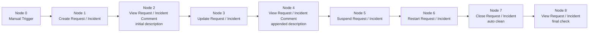

# User guide - How to test the EasyVista ticket lifecycle with a playbook

## Guide Objective

The EasyVista Service Manager module exposes separate actions to create, update, suspend, restart and close a request or incident. Each one is tested on its own, but a SOC playbook chains them on the same ticket. Running that chain end to end is the best way to confirm the integration works.

Every action after creation references the ticket by the `rfc_number` returned by `Create Request / Incident`. The playbook below passes that value from node to node with no hard-coded ticket ID.

This document shows how to set up the playbook step by step: create, check the description, update, suspend, restart, close, then check the final state. The ticket created by a run is closed by the same run, so each run starts from a clean state and gives the same result as the previous one.

## Initial Context (Template Reference)

The playbook below uses a dedicated integration account and a catalog entry reserved for tests.

- Sekoia account: `<YOUR_EASYVISTA_ACCOUNT>`
- EasyVista server: `<YOUR_EASYVISTA_BASE_URL>`
- EasyVista tenant: `<YOUR_EASYVISTA_TENANT_ID>`
- Test catalog entry: `<YOUR_CATALOG_CODE>`
- Closing status: `<YOUR_CLOSE_STATUS_GUID>`

### Account configuration

Create the account once in **Integrations > EasyVista Service Manager > Accounts**:

| Field | Value |
| --- | --- |
| Name | `<YOUR_EASYVISTA_ACCOUNT>` |
| base_url | `<YOUR_EASYVISTA_BASE_URL>` (HTTPS protocol and host, without a path) |
| tenant_id | `<YOUR_EASYVISTA_TENANT_ID>` (keep any leading zeros) |
| use_token | `true` (recommended) or `false` for Basic authentication |
| token | EasyVista access token, required when `use_token` is `true` |
| username / password | REST API user login and password, required when `use_token` is `false` |
| verify_ssl | `true` |

Select this account on every EasyVista action node of the playbook.

### Placeholder Reference

Use the placeholders below in your playbook values.

| Placeholder | Example value | Purpose |
| --- | --- | --- |
| `<YOUR_EASYVISTA_ACCOUNT>` | `<easyvista_community_account>` | Sekoia account used by all EasyVista actions |
| `<YOUR_EASYVISTA_BASE_URL>` | `https://customer-example.easyvista.com` | EasyVista server URL |
| `<YOUR_EASYVISTA_TENANT_ID>` | `50005` | EasyVista account number |
| `<YOUR_CATALOG_CODE>` | `62` | Catalog entry code; sets the ticket workflow |
| `<YOUR_TICKET_TITLE>` | `sekoia_playbook_lifecycle_test` | Title of the test ticket |
| `<YOUR_INITIAL_DESCRIPTION>` | `Created by the Sekoia lifecycle playbook` | Description set at creation |
| `<YOUR_APPENDED_DESCRIPTION>` | `Updated by the Sekoia lifecycle playbook` | Text appended by `Update Request / Incident` |
| `<YOUR_URGENCY_ID>` | `2` | Urgency ID set by the update (tenant-specific) |
| `<YOUR_EXTERNAL_REFERENCE>` | `sekoia-playbook-lifecycle-test` | External reference set by the update (for example a Sekoia alert ID) |
| `<YOUR_SUSPEND_COMMENT>` | `Suspended by the Sekoia lifecycle playbook` | Comment of the suspend action |
| `<YOUR_RESTART_COMMENT>` | `Restarted by the Sekoia lifecycle playbook` | Comment of the restart action |
| `<YOUR_CLOSE_STATUS_GUID>` | `DC97DD1D-0F35-4153-B0E1-0F2E0155365D` | Final status GUID ("Solved" in the vendor example); tenant-specific |
| `<YOUR_CLOSE_COMMENT>` | `Closed by the Sekoia lifecycle playbook` | Comment of the closing action |

**Notes:**

- `<YOUR_CATALOG_CODE>`, `<YOUR_URGENCY_ID>` and `<YOUR_CLOSE_STATUS_GUID>` depend on the EasyVista tenant. Ask the EasyVista administrator for values that apply to the test catalog entry.
- `status_guid` is optional on `Close Request / Incident`. When it is empty, the ticket goes to the Closed meta-status.

## Playbook - Ticket Lifecycle Flow (Create -> Update -> Suspend -> Restart -> Close)

**Goal:** create a test ticket, run every lifecycle action on it, and close it at the end so the next run starts from the same state.



### Node 0 - Manual Trigger

**Type:** Trigger

**Description:** Starts the playbook execution manually.

### Node 1 - Create Request / Incident

**Type:** Action create_request_incident

**Description:** Creates the test ticket and returns its `rfc_number`, which all later nodes use.

**Inputs:**

- requests:

```json
[
  {
    "catalog_code": "<YOUR_CATALOG_CODE>",
    "title": "<YOUR_TICKET_TITLE>",
    "description": "<YOUR_INITIAL_DESCRIPTION>"
  }
]
```

**Outputs:**

- `{{ node.1.rfc_number }}`: ticket RFC number, taken from the last segment of the ticket URL
- `{{ node.1.href }}`: ticket URL

**Notes:**

- `requests` must contain exactly one ticket.
- Each run creates a new ticket with a new `rfc_number`. The title can stay the same between runs, because no later node looks the ticket up by title.
- Optional fields (`urgency_id`, `impact_id`, `recipient_name`, `recipient_mail`, `department_code`, `location_id`, `custom_fields`) can be added if the catalog entry requires them.

### Node 2 - View Request / Incident Comment (initial description)

**Type:** Action view_request_incident_comment

**Description:** Reads the ticket comment to check that the description was stored at creation.

**Inputs:**

- rfc_number: `{{ node.1.rfc_number }}`

**Expected result:**

- `comment`: `<YOUR_INITIAL_DESCRIPTION>`

### Node 3 - Update Request / Incident

**Type:** Action update_request_incident

**Description:** Appends text to the description and updates the urgency and the external reference.

**Inputs:**

- rfc_number: `{{ node.1.rfc_number }}`
- append: `true`
- description: `<YOUR_APPENDED_DESCRIPTION>`
- urgency_id: `<YOUR_URGENCY_ID>`
- external_reference: `<YOUR_EXTERNAL_REFERENCE>`

**Notes:**

- With `append: true`, the new text is added after the existing one, separated by `<br><br>` (EasyVista Service Manager 2025.3 or later). With `append: false` or unset, the description is replaced.
- `urgency_id` is a string in this action, but an integer in `Create Request / Incident`.

### Node 4 - View Request / Incident Comment (appended description)

**Type:** Action view_request_incident_comment

**Description:** Checks that the update appended the text instead of replacing it.

**Inputs:**

- rfc_number: `{{ node.1.rfc_number }}`

**Expected result:**

- `comment`: `<YOUR_INITIAL_DESCRIPTION><br><br><YOUR_APPENDED_DESCRIPTION>`

### Node 5 - Suspend Request / Incident

**Type:** Action suspend_request_incident

**Description:** Puts the ticket on hold.

**Inputs:**

- rfc_number: `{{ node.1.rfc_number }}`
- comment: `<YOUR_SUSPEND_COMMENT>`

**Notes:**

- The comment is attached to the suspend action. It does not change the ticket comment.
- Suspending a ticket that is already suspended fails with an "already suspended" error.

### Node 6 - Restart Request / Incident

**Type:** Action restart_request_incident

**Description:** Resumes the suspended ticket so it can be closed normally.

**Inputs:**

- rfc_number: `{{ node.1.rfc_number }}`
- comment: `<YOUR_RESTART_COMMENT>`

**Notes:**

- Restarting a ticket that is not suspended fails with a "not suspended" error. Keep Node 5 and Node 6 together: add or remove both.

### Node 7 - Close Request / Incident (auto clean)

**Type:** Action close_request_incident

**Description:** Closes the test ticket. This node is the cleanup step that makes the playbook repeatable: no test ticket stays open after a successful run.

**Inputs:**

- rfc_number: `{{ node.1.rfc_number }}`
- status_guid: `<YOUR_CLOSE_STATUS_GUID>`
- comment: `<YOUR_CLOSE_COMMENT>`
- delete_actions: `false`

**Notes:**

- `end_date` is optional and defaults to now. If you set it, use the `MM/DD/YYYY HH:MM:SS` format.
- `catalog_guid` is only needed to requalify the ticket before closing it. Leave it empty for this test.

### Node 8 - View Request / Incident (final check)

**Type:** Action view_request_incident

**Description:** Reads the ticket after closing to check its final state.

**Inputs:**

- rfc_number: `{{ node.1.rfc_number }}`

**Expected result:**

- `record.RFC_NUMBER`: same value as `{{ node.1.rfc_number }}`
- `record.END_DATE_UT`: set (the ticket is closed)
- `record.STATUS.STATUS_GUID`: `<YOUR_CLOSE_STATUS_GUID>`, or the Closed meta-status if `status_guid` was empty

**Notes:**

- `COMMENT` and `DESCRIPTION` in `record` are links (`{HREF}`), not text. Use `View Request / Incident Comment` to read the text.

## Repeatability

A successful run leaves no open ticket: Node 7 closes the ticket created by Node 1, and Node 8 confirms it. The next run creates a new ticket and does not depend on any earlier one.

Sekoia playbooks have no "finally" branch. If a node between Node 2 and Node 6 fails, the run stops and Node 7 does not run, so the test ticket stays open. To clean it up:

1. Open the failed run and copy `rfc_number` from the Node 1 output.
2. Optionally, check that the ticket is still open with `View Requests / Incidents list`:
   - search: `rfc_number:"<RFC_NUMBER_FROM_FAILED_RUN>"`
   - fields: `rfc_number,submit_date_ut`
   - max_rows: `5`
3. Run `Close Request / Incident` alone with this `rfc_number` and the same inputs as Node 7. If the run stopped at Node 6, the ticket is still suspended: if EasyVista rejects the close, run `Restart Request / Incident` first.

Then run the playbook again.
