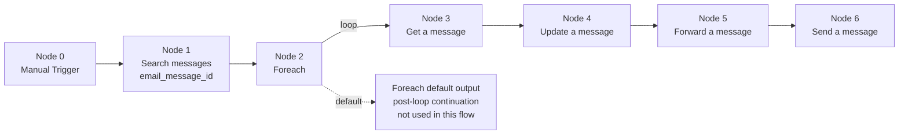

# User guide - How to resolve Outlook Message IDs with a playbook

## Guide Objective

Until now, Defender events could provide `email.message_id` (Internet Message-ID) and `email.local_id` (NetworkMessageId), but Microsoft Graph remediation actions (`get_message`, `delete_a_message`, `forward_message`, `update_message`) require a Graph item ID. This mismatch prevented direct end-to-end remediation from event identifiers alone.

The implemented resolution is to use `search_messages` to find matching messages from `email_message_id` and/or `email_local_id`, then iterate over `messages` with `foreach` and chain remediation actions with the resolved message object or `message_id`.

This document shows how to set up that playbook flow step by step: search, iterate, inspect (`get_message`), remediate (`update_message` / `forward_message`), and optionally send follow-up communications (`send_message`).

## Initial Email Context (Template Reference)

The playbook below is based on this example email, which has already been created and sent, to build and validate the workflow end to end.

- Subject: <YOUR_TEST_SUBJECT>
- Internet Message-ID: <YOUR_INTERNET_MESSAGE_ID>
- Network Message ID (email.local_id): <YOUR_NETWORK_MESSAGE_ID>
- Graph Message Item ID (fallback): <YOUR_GRAPH_MESSAGE_ITEM_ID>
- Created by (sender address): <YOUR_SENDER_EMAIL>
- Stored in tested mailbox: <YOUR_TEST_MAILBOX_USER>

**Placeholder examples:**

- <YOUR_TEST_SUBJECT> = `E2E-OUTLOOK-2026-10-13-01`
- <YOUR_INTERNET_MESSAGE_ID> = `<CAFakeMsgId-7f3a2b4c9d8e1f2a@example.mail>`
- <YOUR_NETWORK_MESSAGE_ID> = `3f1c2a9d-4b8e-4f6a-b1d3-2a7e9c4d5f10`
- <YOUR_GRAPH_MESSAGE_ITEM_ID> = `AAMkAGI2ZmFrZS1iM2Q0LTQ1NjctODkwYS1hYmNkZWYxMjM0NQBGAAAAAAC0FakeBase64SegmentAAAAAAEMAAB0FakeBase64SegmentAAABcDEfAAA=`
- <YOUR_SENDER_EMAIL> = `analyst@customer-example.com`
- <YOUR_TEST_MAILBOX_USER> = `soc-automation@customer-example.onmicrosoft.com`

## Playbook - Message Processing Flow (Search -> Get -> Update -> Forward -> Send)

**Goal:** resolve Graph item IDs from Defender message identifiers, then execute the remediation chain (get, update, forward, send) on resolved messages.

### Node 0 - Manual Trigger

**Type:** Trigger

**Description:** Starts the playbook execution manually.

### Node 1 - Search messages (email_message_id)

**Type:** Action search_messages

**Description:** Finds candidate messages using `email_message_id`, `email_local_id`, or both together, then exposes a list for iteration.

**Inputs:**

- user: <YOUR_TEST_MAILBOX_USER>
- email_message_id: <YOUR_INTERNET_MESSAGE_ID>
- max_messages_to_return: 10
- return_most_recent_first: false

**Notes:**

- For strict correlation when both identifiers are available, pass both `email_message_id` and `email_local_id` in the same search.
- `return_most_recent_first=true` requests results sorted by `receivedDateTime` descending; `false` does not force this sort order.

### Node 2 - Foreach (iterate Search messages output)

**Type:** Operator foreach

**Description:** Iterates over each message returned by Node 1.

**Inputs:**

- Items: {{ node.1.messages }}

**Connection:**

- Connect Node 3 (Get a message) from the Foreach output channel labeled loop.
- Do not connect Node 3 from the unlabeled/default output, which is intended for post-loop continuation.

**Notes:**

- With this setup, {{ node.2.default.value }} is a full message object containing message_id.

### Node 3 - Get a message

**Type:** Action get_message

**Description:** Retrieves full message details for the current foreach item.

**Inputs:**

- user: {{ node.1.user }}
- message_id: {{ node.2.default.value }}

**Notes:**

- Get/Update/Forward/Delete accept either a string message_id or a message object containing message_id.

### Node 4 - Update a message

**Type:** Action update_message

**Description:** Updates the selected message subject/body to validate update behavior.

**Inputs:**

- user: {{ node.1.user }}
- message_id: {{ node.3.message_id }}
- subject: <UPDATED_SUBJECT>
- content: <UPDATED_BODY_CONTENT>

### Node 5 - Forward a message

**Type:** Action forward_message

**Description:** Forwards the updated message to the target recipient list.

**Inputs:**

- user: {{ node.1.user }}
- message_id: {{ node.4.message_id }}
- recipients: [<TARGET_RECIPIENT_EMAIL>]
- comment: <FORWARD_COMMENT>

### Node 6 - Send a message

**Type:** Action send_message

**Description:** Sends a brand-new outbound message to validate send behavior.

**Inputs:**

- user: {{ node.1.user }}
- subject: <OUTBOUND_SUBJECT>
- content: <OUTBOUND_BODY_CONTENT>
- sender: {{ node.1.user }}
- from: {{ node.1.user }}
- recipients: [<TARGET_RECIPIENT_EMAIL>]
- content_type: text
- save_to_sent_items: true
