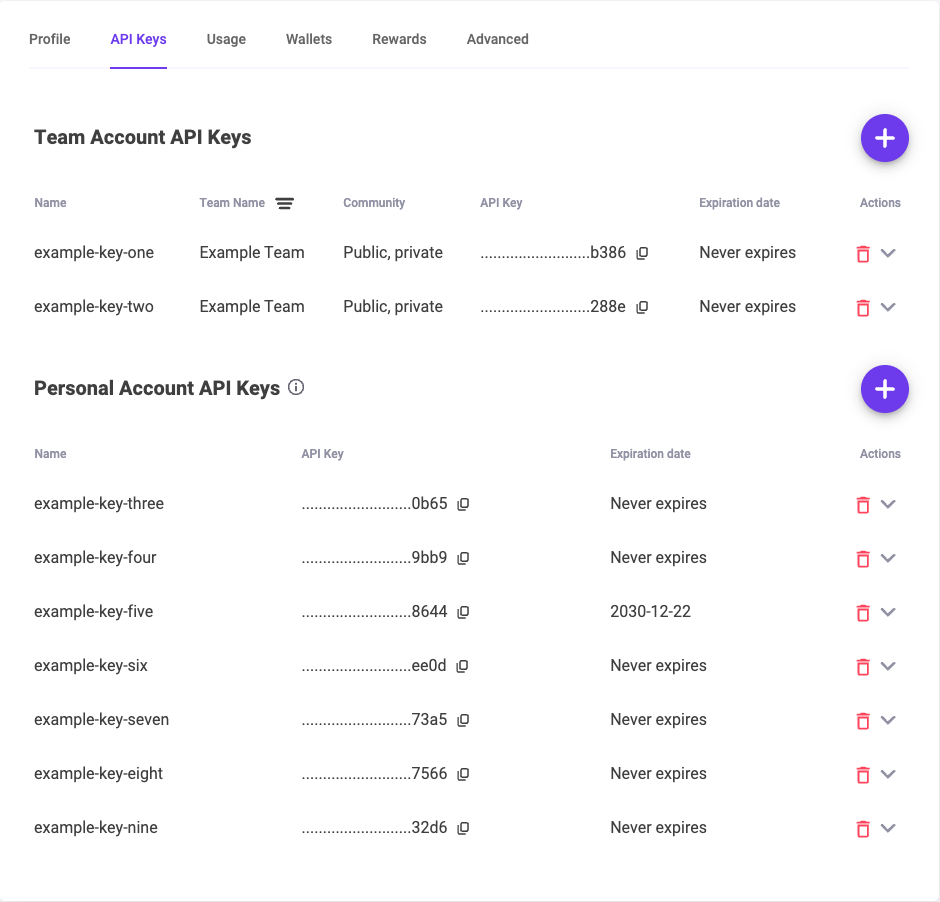
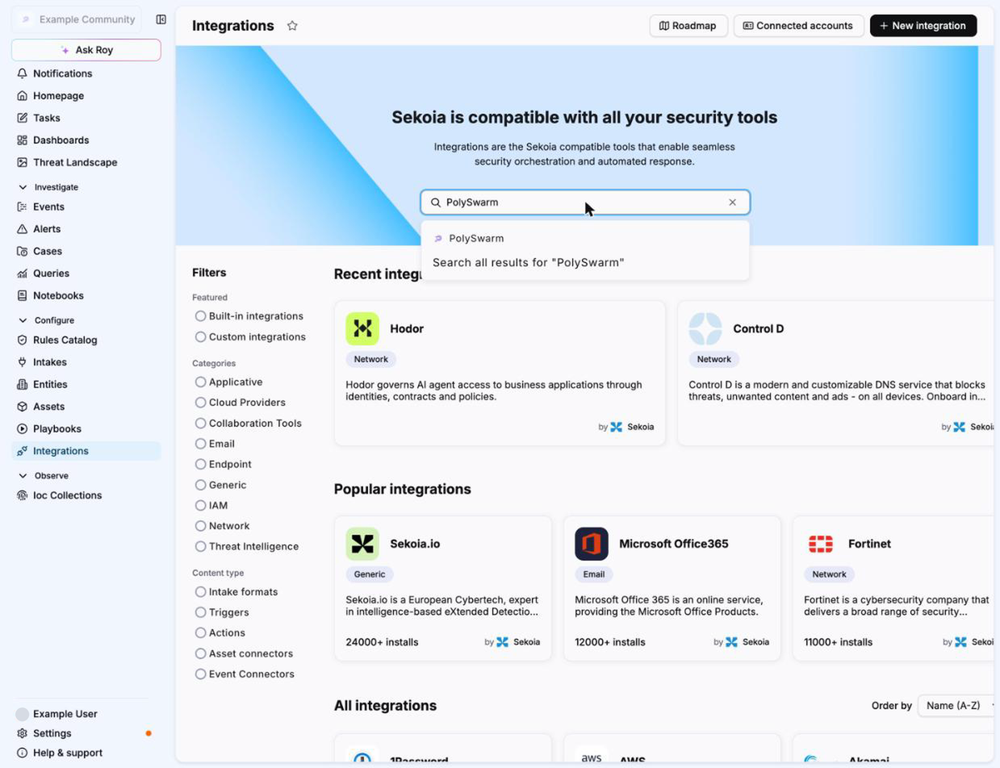
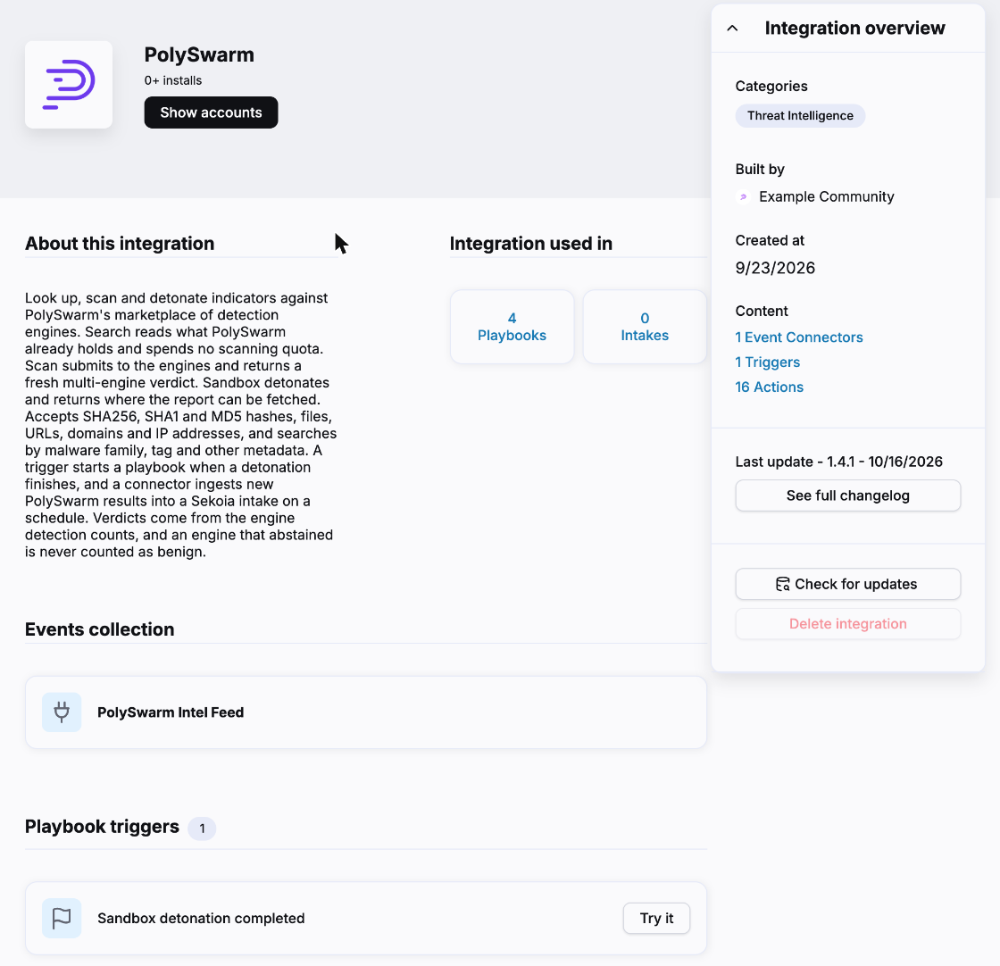
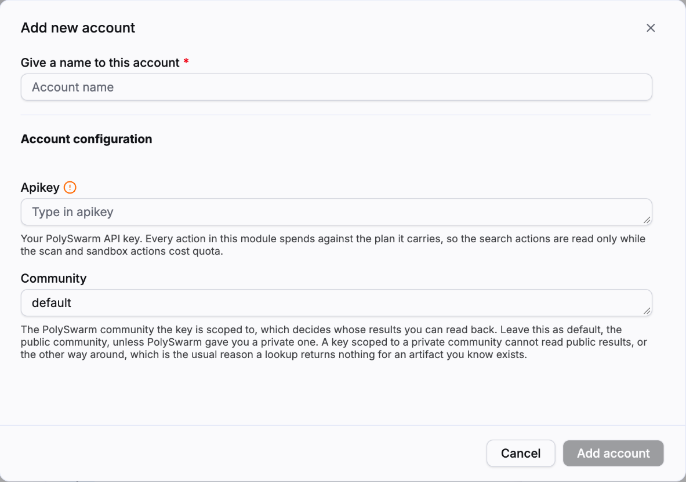
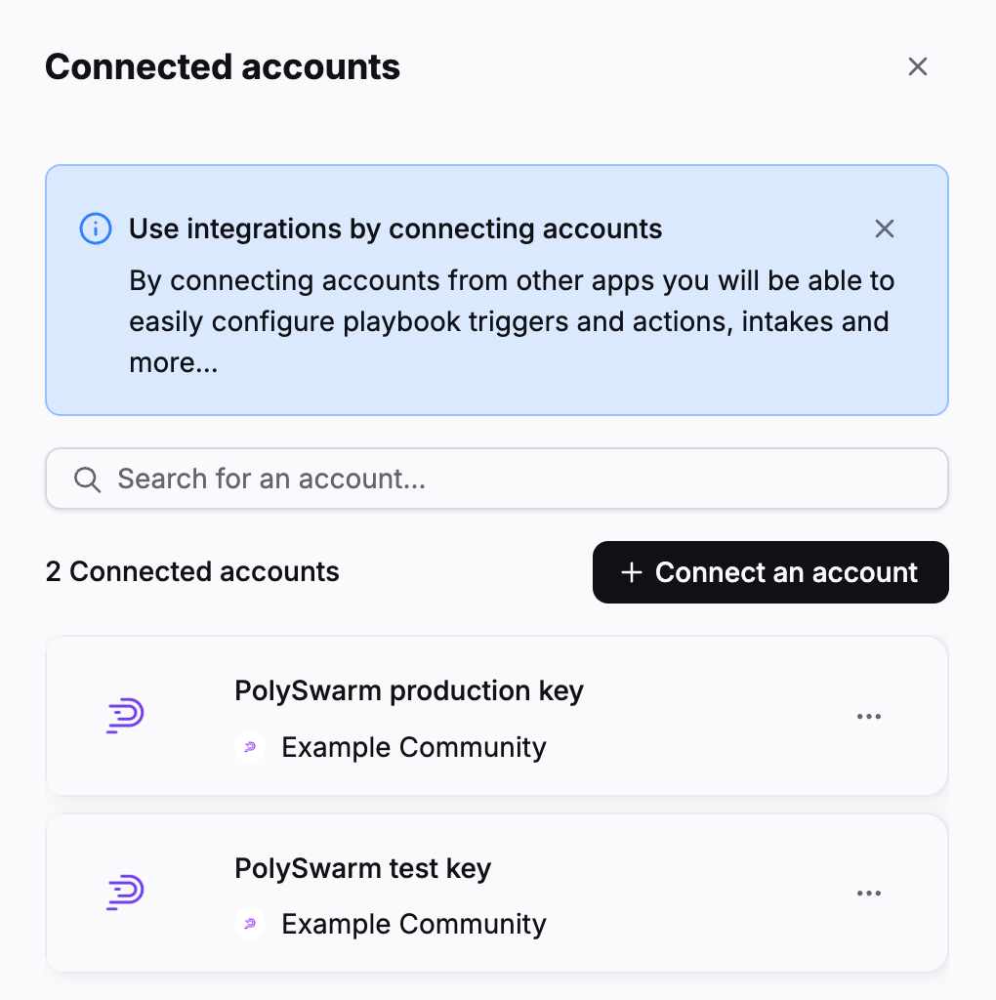
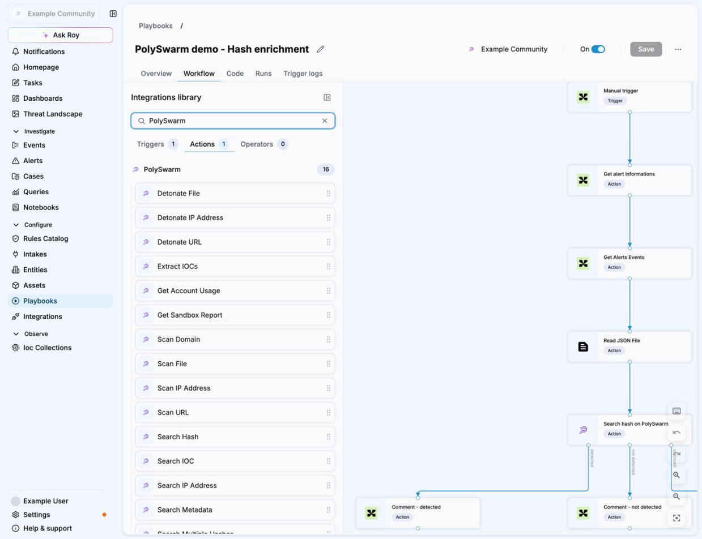
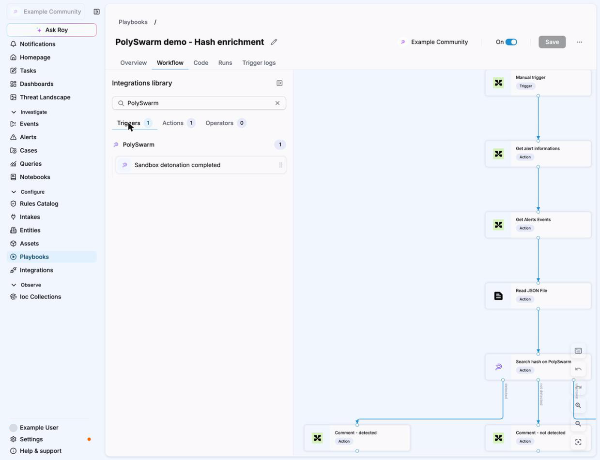

## Configuration

PolySwarm answers one question: has anything in the industry seen this file, hash, URL, domain or address before, and what did it say. Several dozen engines assert on each artifact and this module reports what they found. It can also detonate a file or a URL in a sandbox and hand the report back to a playbook.

You need two things: an API key, and the name of the community that key belongs to.

### In PolySwarm, find your API key

1. Sign in at `polyswarm.network`.
2. Click the gear icon in the top bar, then `Settings`, then the `API Keys` tab.
3. Keys issued to a team are listed under `Team Account API Keys`, with the community each one is scoped to in the `Community` column. Keys issued to you personally are under `Personal Account API Keys`.
4. Use the copy icon beside the key you want. The key stays masked on screen, so copy it rather than trying to read it.

    

If you do not have a key, the round `+` button on either section creates one, or your PolySwarm contact can issue one for your team.

### In Sekoia.io, connect the account

5. Go to `Configure`, then `Integrations`, and search for `PolySwarm`.

    
6. On the PolySwarm page, click `Show accounts`, then `+ Connect an account`.

    
7. Give the account a name you will recognise in a playbook, for example the team the key belongs to.
8. Paste the key into `API Key`. The field is declared as a secret, so the platform masks it.
9. Set `Community`. It is prefilled with `default`, which is the public community and is where most keys belong. If PolySwarm issued you a key for a private community, put that community's name here instead.

    
10. Click `Add account`. It then appears under `Connected accounts` and can be selected by any PolySwarm action or trigger in a playbook.

    

A word about the community field, because it is the one thing the two products do not line up on. The PolySwarm portal describes a key's community in words, as public or private, and never shows the exact name Sekoia wants typed here. If lookups come back empty for artifacts you are certain exist, this field is almost always the reason, and your PolySwarm contact can tell you the exact value.

### Using it in a playbook

11. Open a playbook under `Configure`, then `Playbooks`, and click the `+` on the canvas.
12. Search for `PolySwarm`. The `Actions` tab lists every action, and the `Triggers` tab holds `Sandbox detonation completed`.

    

    

The search actions branch on their outcome, so a hash search leads to `detected`, `not detected` and `unknown` outputs you can wire to different steps. The `unknown` branch matters: it is what fires when PolySwarm has never seen the artifact, or when a scan has not finished, and it is deliberately not the same as `not detected`.

### Before you wire this into something that runs on every alert

- **The search actions are read only.** They look up what is already known and cost almost nothing. The scan actions submit the artifact to the engines and the detonate actions run it in a sandbox. Those spend against your plan.
- **Bulk lookup is a loop, not a batch.** PolySwarm has no batch hash endpoint, so fifty hashes cost fifty requests. Duplicates are charged once. A usage limit stops the run and returns the rows already gathered rather than failing outright, and so does a refused key, an unreachable platform, several failures in a row or a ten minute time bound. A run stopped that way reports `partial`, which must not be read as a clean answer for the hashes it never reached.
- **Getting an existing sandbox report is quick. Creating one is not.** A fresh detonation can take roughly fifteen minutes. For anything time sensitive, submit the artifact and let the `Sandbox detonation completed` trigger start the playbook that handles the result, rather than blocking an action on it.

### What a result does and does not mean

- **An artifact nobody has seen is not an error.** A hash search that finds nothing reports the artifact as not found, so a playbook can route it to a detonation step instead of failing.
- **A scan with no verdict is never reported as clean.** Three cases come back as unknown rather than as zero detections: an assertion window still open, a failed scan, and a window that closed without a single engine returning a malicious or benign answer. That last case is the one worth knowing about, because engines abstain routinely and coverage is thinnest on addresses and domains. Engines that abstained are counted as neither malicious nor benign. The opposite behaviour would tell a playbook a sample is clean when nobody has actually looked at it.
- **A sandbox verdict and an engine verdict are different things and can disagree.** A file that every engine flags can behave inertly under detonation and score low, so a low sandbox score means the sample did nothing in that sandbox, not that it is safe. Use a hash search for the engine view and a sandbox report for behaviour.
- **For a URL, a domain or an address, use the detection counts rather than the score.** The score carries little information for those. For files it is meaningful across its full range.

### Checking it worked

The cheapest proof that the key and the community are both right is a hash search, because it is read only. Run `Search Hash` against a hash you know is malicious and confirm the engine detections come back. If it reports the artifact as not found for something the industry has certainly seen, go back to the community field.
