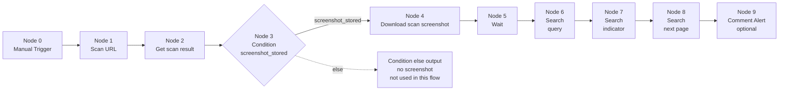

# User guide - How to test the urlscan.io actions with a playbook

## Guide Objective

The urlscan.io module provides four actions: `Scan URL`, `Get scan result`, `Download scan screenshot` and `Search`. Each one has unit tests and end-to-end tests against the live API, but neither shows how the actions behave when they are chained in a Sekoia.io playbook. That is where Jinja templating, the playbook run storage and the comment rendering come into play.

This document shows how to build a playbook that runs the four actions in sequence on the same scan, and how to check their results node by node:

- submit a URL and wait for the scan (`Scan URL`)
- read the same scan again (`Get scan result`)
- branch on the screenshot availability, then store the PNG in the run (`Download scan screenshot`)
- find the scan back, by query and by indicator, and page through the results (`Search`)
- optionally, post the ready-to-post comment on an alert to check that the screenshot is displayed

The playbook is repeatable: each run submits one new `private` scan of the same URL, and every later node reads the identifiers of that run through templates, so no value has to be changed between runs.

## Initial Test Context (Template Reference)

The playbook below is based on the following context, which must exist before the first run.

- urlscan.io module configured with: `<YOUR_URLSCAN_TEAM_API_KEY>` (see `CONFIGURE.md`)
- URL to scan: `<YOUR_SCAN_URL>`
- Alert used to check the comment (optional): `<YOUR_TEST_ALERT_UUID>`, the identifier of the alert from which the playbook is run
  - It is the last part of the alert URL: in `https://app.sekoia.io/alerts/<ALERT_ID>`, it is `<ALERT_ID>`
  - It is also shown, ready to copy, in the `ID` field just under the alert title

### Placeholder Reference

Use the placeholders below in your playbook values.

| Placeholder | Example value | Purpose |
| --- | --- | --- |
| `<YOUR_URLSCAN_TEAM_API_KEY>` | `0a1b2c3d-1234-4abc-9def-0123456789ab` | Team API key set in the module configuration (never in a node) |
| `<YOUR_SCAN_URL>` | `https://example.com` | Harmless URL scanned on every run |
| `<YOUR_SCAN_TAGS>` | `["sekoia-e2e", "sekoia-playbook"]` | Tags of the scan, used to find test scans on urlscan.io |
| `<YOUR_SCAN_COUNTRY>` | `FR` | Country to scan from; upper case on purpose, the action lowercases it |
| `<YOUR_CUSTOM_USER_AGENT>` | `Mozilla/5.0 (Sekoia.io e2e)` | User-Agent of the scan, visible in the raw result |
| `<YOUR_INDEXING_WAIT_SECONDS>` | `60` | Time for urlscan.io to index the new scan before searching it |
| `<YOUR_SEARCH_PAGE_SIZE>` | `5` | Page size of the indicator search, small enough to get a second page |
| `<YOUR_TEST_ALERT_UUID>` | `ALaBcDeFgHiJ` | Identifier of the alert from which the playbook is run, which receives the comment (optional node): last part of the alert URL, or `ID` field under the alert title |
| `<YOUR_COMMENT_AUTHOR>` | `urlscan.io` | Author of the comment (32 characters at most) |

**Quota:** each run consumes one `private` scan and a few `retrieve` and `search` requests of the team quotas.

## Playbook - URL Scan Flow (Scan -> Get -> Condition -> Download -> Wait -> Search)

**Goal:** submit one URL, then exercise the four urlscan.io actions on that scan and check that each node returns the expected values.

### Node 0 - Manual Trigger

**Type:** Trigger

**Description:** Starts the playbook execution manually.

### Node 1 - Scan URL

**Type:** Action urlscan.io > Scan URL

**Description:** Submits the URL with the four user options, waits for the scan, and returns the scan summary with the ready-to-post comment.

**Inputs:**

- url: `<YOUR_SCAN_URL>`
- visibility: `private`
- tags: `<YOUR_SCAN_TAGS>`
- country: `<YOUR_SCAN_COUNTRY>`
- customagent: `<YOUR_CUSTOM_USER_AGENT>`
- fail_on_blacklisted_url: `true`
- wait_for_result: `true`
- timeout: `120`

**Expected results:**

- `status` is `done`, `visibility` is `private`, `tags` lists `<YOUR_SCAN_TAGS>`
- `uuid` is a new UUID on every run
- `submitted_url` starts with `<YOUR_SCAN_URL>`
- `report_url`, `result_api_url`, `screenshot_url` and `dom_url` all contain `uuid`
- `screenshot_available` and `dom_available` are `true`
- `verdict.malicious` is `false`, `page.status` is `200`
- `comment` starts with `**urlscan.io scan** of` and contains ``

**Notes:**

- The node usually takes 10 to 20 seconds: the action waits 10 seconds after the submission, then polls urlscan.io every 2 seconds
- `wait_for_result=false` would return right after the submission with `status` = `submitted` and most fields empty; it is not used here, so that every later node has a finished scan to work on
- A URL on an internal host (for example `http://10.0.0.1/`) is refused before any call to urlscan.io, see [Failure checks](#failure-checks)

### Node 2 - Get scan result

**Type:** Action urlscan.io > Get scan result

**Description:** Reads the summary of the scan submitted by Node 1, as a playbook would for a scan found with Search or submitted without waiting.

**Inputs:**

- scan_id: `{{ node.1.uuid }}`

**Expected results:**

- Same summary as Node 1: same `uuid`, `verdict`, `page`, `contacted`, links and `comment`

### Node 3 - Condition (screenshot stored)

**Type:** Operator condition

**Description:** Continues only when urlscan.io stored the screenshot, which is the condition the spec recommends before downloading it.

**Inputs:**

- Case name: `screenshot_stored`
- Left: `{{ node.2.screenshot_available }}`
- Comparison: `==`
- Right: `True`

**Connection:**

- Connect Node 4 (Download scan screenshot) from the output channel labeled `screenshot_stored`
- Do not connect Node 4 from the `else` output, which is taken when the screenshot is not stored (or could not be checked)

**Notes:**

- `screenshot_available` is a boolean (or `null` when the check failed): the rendered template gives `True`, `False` or `None`, so the right value is `True` with a capital letter

### Node 4 - Download scan screenshot

**Type:** Action urlscan.io > Download scan screenshot

**Description:** Downloads the PNG of the scan into the playbook run storage.

**Inputs:**

- scan_id: `{{ node.2.uuid }}`

**Expected results:**

- `screenshot_path` is `urlscan/<uuid>.png`, where `<uuid>` is `{{ node.1.uuid }}`
- `screenshot_url` is the `screenshot_url` of Node 1
- `size` is a few tens of thousands of bytes

**Notes:**

- The file stays in the run for 8 days: any later action of the same run can read it through a `*_path` argument set to `{{ node.4.screenshot_path }}`
- Users who can view playbook runs can download it; a screenshot of a phishing page may show victim data

### Node 5 - Wait

**Type:** Action Utils > Wait

**Description:** Gives urlscan.io time to index the new scan, so that Search finds it.

**Inputs:**

- duration: `<YOUR_INDEXING_WAIT_SECONDS>`

**Notes:**

- A scan is usually searchable a few seconds after it finishes, but it can take up to a minute; without this wait, Node 6 may return no result

### Node 6 - Search (query)

**Type:** Action urlscan.io > Search

**Description:** Finds the scan of this run with an Elasticsearch query, which also checks that a `private` scan of the team is searchable.

**Inputs:**

- query: `task.uuid:{{ node.1.uuid }}`
- size: `10`

**Expected results:**

- `query` is `task.uuid:<uuid>`
- `results` holds exactly one row, whose `uuid` is `{{ node.1.uuid }}` and whose `visibility` is `private`
- `next_search_after` is `null`, because the page holds fewer rows than `size`

**Notes:**

- If `results` is empty, urlscan.io had not indexed the scan yet: increase `<YOUR_INDEXING_WAIT_SECONDS>` and run the playbook again

### Node 7 - Search (indicator)

**Type:** Action urlscan.io > Search

**Description:** Searches the final domain of the scan as an indicator: the action builds the query itself.

**Inputs:**

- indicator: `{{ node.2.page.domain }}`
- size: `<YOUR_SEARCH_PAGE_SIZE>`

**Expected results:**

- `query` is `domain:"<domain>"`, for example `domain:"example.com"`
- `results` holds `<YOUR_SEARCH_PAGE_SIZE>` rows, each with a `uuid`, a `report_url` and a `screenshot_url`
- `next_search_after` is not `null`, because the page is full

**Notes:**

- Provide exactly one of `indicator` or `query`
- The indicator type is detected from its value: an IP gives `ip:"..."`, a SHA256 gives `hash:"..."`, a URL gives `page.url:"..."`, anything else gives `domain:"..."`
- The rows include public scans of other urlscan.io users, so their values change from one run to the next

### Node 8 - Search (next page)

**Type:** Action urlscan.io > Search

**Description:** Reads the next page of Node 7, to check pagination.

**Inputs:**

- indicator: `{{ node.2.page.domain }}`
- size: `<YOUR_SEARCH_PAGE_SIZE>`
- search_after: `{{ node.7.next_search_after }}`

**Expected results:**

- `results` holds `<YOUR_SEARCH_PAGE_SIZE>` rows, none of them with a `uuid` already returned by Node 7

### Node 9 - Comment Alert (optional)

**Type:** Action Sekoia.io > Comment Alert

**Description:** Posts the ready-to-post comment of the scan on an alert, to check how it is displayed to analysts.

**Inputs:**

- uuid: `<YOUR_TEST_ALERT_UUID>`, the identifier of the alert from which the playbook is run (`<ALERT_ID>` in `https://app.sekoia.io/alerts/<ALERT_ID>`; also shown, ready to copy, in the `ID` field just under the alert title)
- content: `{{ node.2.comment }}`
- author: `<YOUR_COMMENT_AUTHOR>`

**Expected results (in the alert, in the web app):**

- The first line shows the scanned URL in a code span, not as a clickable link, followed by the verdict and the score
- A two-column table shows the final URL, the IP / ASN / country, the page title, the categories / brands, the engines and the scan time
- The `urlscan.io report`, `Screenshot` and `DOM` links are clickable
- The screenshot image is displayed under the links

**Notes:**

- The image is loaded from urlscan.io by the analyst's browser, without any urlscan.io account: the screenshot and report links of a `private` scan are visible to every user who can read the alert
- *Comment case* (`uuid` of a case, `content`) works the same way

## Failure Checks

Each check below is a separate playbook made of a *Manual Trigger* and one action. The action must fail with the given message, and no scan is consumed.

| Action | Inputs | Expected error |
| --- | --- | --- |
| Get scan result | scan_id: `00000000-0000-0000-0000-000000000000` | `Scan 00000000-0000-0000-0000-000000000000 not found or not finished yet` |
| Download scan screenshot | scan_id: `00000000-0000-0000-0000-000000000000` | `Screenshot of scan 00000000-0000-0000-0000-000000000000 was not stored by urlscan.io (or the scan is unknown or not finished)` |
| Download scan screenshot | scan_id: `../etc/passwd` | `'../etc/passwd' is not a valid scan UUID` |
| Scan URL | url: `http://10.0.0.1/admin` | `The URL host '10.0.0.1' is a private address and will not be sent to urlscan.io` |
| Scan URL | url: `https://phishing.invalid/` | `The URL host 'phishing.invalid' only exists inside a network and will not be sent to urlscan.io` |
| Search | indicator: `example.com`, query: `domain:example.com` | `Provide exactly one of "indicator" or "query"` |
